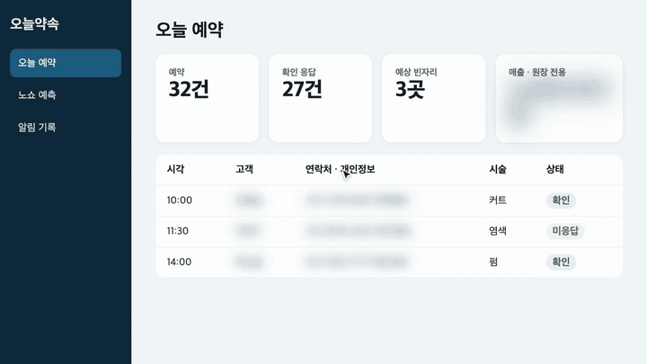

# Omni AI Skills

실제 프로젝트를 만들면서 쓰는 AI 에이전트 스킬 모음입니다. Claude Code와 Codex에 연결해 씁니다.

| 스킬 | 하는 일 |
|---|---|
| [**video-showcase**](skills/video-showcase) | 실제로 돌아가는 서비스를 한국어 내레이션 소개 영상으로 만듭니다. 기획, 대본, 화면 녹화와 민감 정보 가림, 음성, 자막, 편집, 검수를 한 흐름으로 진행합니다. |

## video-showcase



가상의 예약 서비스로 만든 시험 영상입니다. 이 스킬의 기준이 된 실제 영상은 [Omni AI Trading 소개(3분 33초)](https://youtu.be/c4FZw6AYRAg)입니다.

- 실제 화면을 녹화하면서 비공개 값을 가립니다.
- 말하는 단어와 화면이 같은 순간을 가리키게 맞춥니다.
- 장면 레시피, 배경음, 효과음을 자동으로 고르고, 바꿔 달라고 한 것만 바꿉니다.
- 내레이션은 이 컴퓨터의 로컬 모델이나 API로 만듭니다.
- 공개 게시는 언제나 따로 승인받습니다.

## 설치

```bash
git clone https://github.com/roadkwonai/omni-ai-skills.git
cd omni-ai-skills
python3 install.py            # Claude Code에 연결(Codex는 --codex)
```

설치한 뒤 에이전트에게 "우리 서비스 소개 영상 만들어줘"라고 요청합니다. 필요한 프로그램, 요청 예시, 샷과 음성 옵션은 [video-showcase 문서](skills/video-showcase/README.md)에 있습니다.

## 라이선스

코드와 문서는 [MIT](LICENSE)입니다. 일부 파일, 글꼴, 음원, 음성 모델은 각자의 라이선스를 따릅니다([NOTICE](skills/video-showcase/assets/NOTICE.md)).
