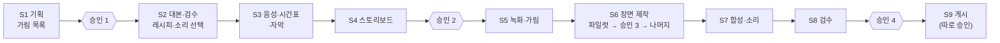
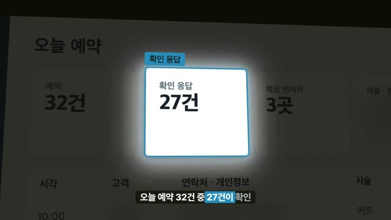
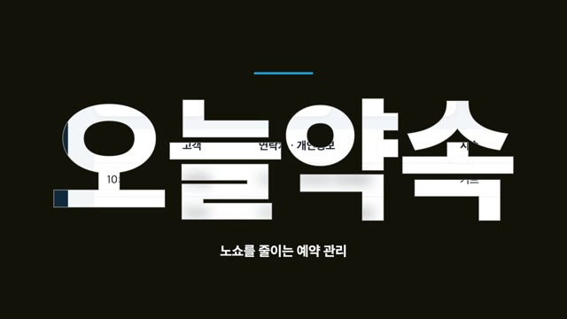
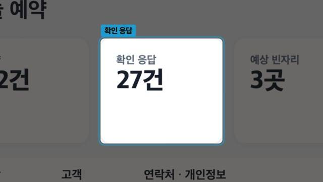
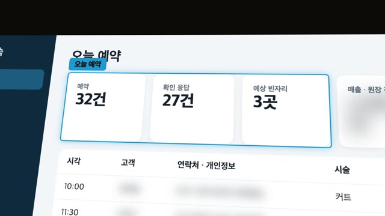
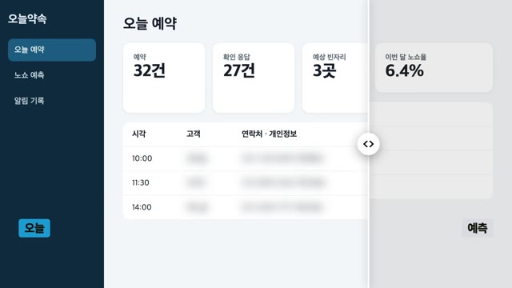
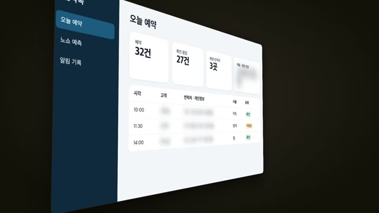
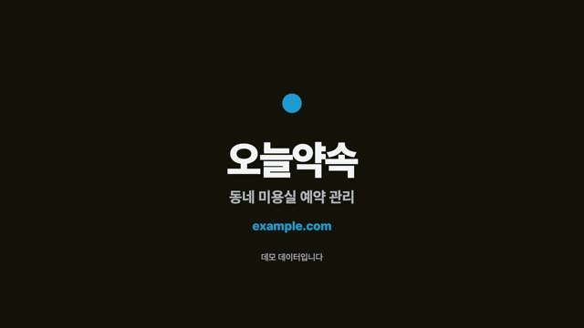

# Service Video Studio

실제로 돌아가는 서비스를 한국어 내레이션 소개 영상으로 만드는 AI 에이전트 스킬입니다. 기획과 대본부터 화면 녹화, 음성, 자막, 편집, 검수, 유튜브 게시 준비까지 한 흐름으로 진행합니다.


> 위 화면은 가상의 미용실 예약 서비스 '오늘약속'으로 만든 시험 영상입니다. 고객 이름·연락처·매출은 녹화 단계에서 가렸습니다. 이 스킬의 기준이 된 실제 영상은 [Omni AI Trading 소개(3분 33초)](https://youtu.be/c4FZw6AYRAg)입니다.

[무엇을 하나요](#무엇을-하나요) · [설치](#설치) · [사용법](#사용법) · [제작 흐름](#제작-흐름) · [레시피와 소리](#레시피와-소리) · [음성](#음성) · [가림](#민감-정보-가림) · [구조](#프로젝트-구조) · [한계](#시험-결과와-한계) · [라이선스](#라이선스)

## 무엇을 하나요

- **실제 화면을 찍습니다.** 브라우저에서 서비스를 조작하며 녹화하고, 비공개 값은 녹화하는 브라우저에서만 가립니다. 앱과 데이터는 바꾸지 않습니다.
- **말과 화면을 맞춥니다.** 음성에서 단어 시각을 재서, 말하는 단어보다 0.17초 먼저 그 칸이 켜지게 합니다. 자막도 단어마다 강조됩니다.
- **레시피와 소리를 알아서 고릅니다.** 문장의 내용과 영상 분위기에 맞춰 샷, 배경음, 효과음을 고르고 이유를 적습니다. "음악만 더 밝게"처럼 말하면 그것만 바꿉니다.
- **검사하고 보고합니다.** 길이, 음량, 빈 화면, 멈춘 화면, 고른 레시피와 실제 장면의 차이를 기계로 검사하고, 사람이 봐야 할 프레임을 뽑아 줍니다.
- **중요한 순간에는 멈춥니다.** 기획, 스토리보드, 파일럿, 최종본에서 확인을 받습니다. 공개 게시는 언제나 따로 승인받습니다.

음악 쇼릴, 쇼츠, 광고, AI 생성 영상에는 맞지 않습니다.

## 설치

```bash
git clone https://github.com/roadkwonai/service-video-studio.git
cd service-video-studio
python3 install.py
```

`~/.claude/skills/`에 연결하고 준비 상태를 알려 줍니다. Codex는 `python3 install.py --codex`, 상태만 볼 때는 `python3 install.py --check`를 씁니다. Codex에서 영상을 끝까지 만들어 보지는 않았습니다.

| 필요한 것 | 쓰는 곳 | 없을 때 |
|---|---|---|
| Python 3.12+, Node.js, ffmpeg | 전체 | 필수 |
| ego-browser CLI(ego lite) | 화면 녹화와 가림 | 직접 찍은 영상을 `assets/clips/`에 넣습니다 |
| 로컬 음성 모델 또는 Fish Audio API 키 | 한국어 내레이션 | 직접 녹음해 `assets/vo_raw/`에 넣습니다 |

HyperFrames 0.9.72와 Remotion 4.0.484는 처음 쓸 때 `npx`·`npm`이 받습니다. macOS(Apple Silicon)에서만 확인했습니다.

로컬 모델이 설치돼 있으면 새 프로젝트는 로컬 Drama 3를 씁니다. API를 쓸 때는 키를 환경변수 `FISH_AUDIO_API_KEY`나 `.env` 파일에 두며, 이때만 대본 글이 Fish Audio로 전송됩니다.

## 사용법

에이전트에게 평소 말로 요청합니다.

```text
http://localhost:3000 에서 돌아가는 우리 서비스 소개 영상을 1분 30초로 만들어줘.
설명은 README.md에 있고, 고객 이름과 매출은 나오면 안 돼.
```

```text
중간에 묻지 말고 30초 데모 영상을 끝까지 만들어줘. 게시는 하지 마.
```

만든 뒤에는 바꾸고 싶은 것만 말하면 됩니다.

| 하고 싶은 것 | 이렇게 말합니다 |
|---|---|
| 오프닝 바꾸기 | "오프닝을 글자 속으로 화면이 나오는 걸로 바꿔줘" |
| 음악 바꾸기 | "음악을 더 경쾌하게", "음악 빼줘", "이 파일을 깔아줘" |
| 음악 들어 보기 | "배경음 후보를 들려줘" |
| 목소리 바꾸기 | "젊은 여성 목소리로", "목소리 후보를 들려줘", "이 문장만 더 천천히" |
| 다른 샷 찾기 | "전환에 쓸 만한 shotcraft 샷을 보여줘" |
| 지정 풀기 | "마무리는 다시 자동으로 골라줘" |
| 대본 고치기 | "세 번째 문장을 이렇게 바꿔줘"(음성과 그 장면을 다시 만듭니다) |

## 제작 흐름



시간표를 장면보다 먼저 정합니다. 다 만든 영상을 나중에 자르고 빠르게 돌리면 전환과 효과음이 잘리기 때문입니다.

`script.json` 하나가 원본입니다. 대본, 읽기, 쉼, 자막 밝기, 효과음, 고른 레시피가 모두 여기 있고 시간표, 자막, `index.html`은 여기서 다시 만들어집니다.

<details>
<summary>에이전트 없이 명령으로 돌리기</summary>

```bash
S=skill/service-video-studio/scripts
W=~/videos/my-service

python3 $S/new_project.py $W "내 서비스 소개" 60-90   # 목표 60~90초
# $W/script.json 의 parts·lines 를 채웁니다
python3 $S/review_script.py $W                        # 대본 검수
python3 $S/pick.py $W                                 # 레시피·배경음·효과음 자동 선택
python3 $S/tts.py $W                                  # 음성(API를 쓰면 --env .env)
python3 $S/timeline.py $W                             # 시간표
python3 $S/words.py $W                                # 단어 시각과 자막
python3 $S/make_index.py $W                           # 장면 틀
python3 $S/record.py $W p1 http://localhost:3000/     # 녹화(capture/p1.scene.js)
# compositions/ 와 remotion/tours.json 을 채우고 샷을 렌더합니다
cd $W && npx --yes hyperframes@0.9.72 check
npx --yes hyperframes@0.9.72 render --output renders/vo.mp4
python3 $S/mix_audio.py $W renders/vo.mp4 renders/final.mp4
python3 $S/qa.py $W renders/final.mp4
```

</details>

## 레시피와 소리

### 값만 넣으면 되는 샷

| | | |
|---|---|---|
| <br/>**SpotTour** 말하는 칸을 차례로 비춤 | <br/>**TextMask** 글자 속으로 화면이 흐르다 뛰어듦 | <br/>**CrashZoom** 한 칸으로 확 다가가 멈춤 |
| <br/>**TiltGlide** 기울어진 화면을 훑음 | <br/>**BeforeAfter** 손잡이로 앞뒤 화면 비교 | <br/>**CardFlip** 화면이 뒤집혀 다음 화면 |
| <br/>**Lockup** 화면이 줄며 로고와 이름 | | |

숫자 굴림, 흐름도, 관문, 스위치, 비교표, 기록 카드는 HyperFrames 장면으로 만듭니다. 완성된 장면 예가 [`assets/examples/`](skill/service-video-studio/assets/examples)에 있습니다.

[video-shotcraft](https://github.com/Vincentwei1021/video-shotcraft)의 샷 122개도 이름으로 가져올 수 있습니다. 가져온 샷에는 원본의 가짜 화면과 문구가 들어 있어, 우리 화면·글꼴·색으로 바꾼 뒤에 씁니다.

```bash
python3 $S/pick.py $W                                   # 자동 선택 → RECIPES.md
python3 $S/pick.py $W --set S04=CrashZoom --bgm house-vibez   # 지정하고 고정
python3 $S/pick.py $W --auto S04 bgm                    # 지정을 풀고 자동으로
python3 $S/pick.py $W --list transition                 # 고를 수 있는 것(shotcraft 설명은 원문)
python3 $S/add_shot.py $W gauge-readout-moves           # shotcraft 샷 가져오기
python3 $S/mix_audio.py $W --preview                    # 배경음 미리듣기
```

### 배경음과 효과음

| 분위기 | 배경음 | 효과음 세트 |
|---|---|---|
| `calm` 차분함 | Tonight (힙합 103 BPM) | `clean` 합성한 절제된 소리 |
| `heavy` 묵직함 | G Eazy NBA type (힙합 86 BPM) | `clean` |
| `bright` 경쾌함 | House Vibez (하우스 123 BPM) | `soft` 부드러운 공기 전환 |
| `fast` 빠름 | Cat Walk (하우스 129 BPM) | `cinematic` 빠른 휙 소리와 충격음 |

곡마다 녹음 크기가 10dB 가까이 달라 같은 크기로 맞추고, 내레이션이 나오면 자동으로 낮춥니다. 최종 음량은 −14 LUFS입니다. 에이전트는 소리를 들을 수 없어 장르와 빠르기로 고릅니다. 미리듣기로 확인해 주세요.

## 음성

| 엔진 | 어디서 만드나 | 쓸 수 있는 곳 |
|---|---|---|
| `drama-3` (기본) | 이 컴퓨터, Apple Silicon | 최근 12개월 매출 50만 달러 미만이면 상업 이용 가능 |
| `s2-pro` | 이 컴퓨터, Apple Silicon | **연구·비상업만** |
| `fish-api` | Fish Audio 무료 API | API 약관 |

```bash
python3 install.py --local-tts ~/path/to/local-tts    # 이미 설치한 모델을 연결(.venv와 models가 있는 폴더)
skill/service-video-studio/scripts/setup_local_tts.sh  # 새로 설치(Drama 3 약 24GB, S2 Pro 약 11GB를 받음)

python3 install.py --voice 내목소리.mp3 "그 소리가 읽은 말"   # 새 영상의 기본 목소리
python3 $S/tts.py --options                            # 쓸 수 있는 옵션 전부
python3 $S/tts.py $W --engine drama-3                  # 엔진을 정하고 만들기
python3 $S/tts.py $W --audition 4                      # 목소리 후보 4개
python3 $S/tts.py $W --only S03                        # 한 문장만 다시
```

로컬 모델은 목소리 설계(성별·나이·음높이·음색·분위기·설명·장면), 내 목소리 참조, 말투 18종과 직접 쓴 말투, 목표 길이, 대사 안의 쉼·소리·강조, 속도·음정·음량, 샘플링 값과 시드를 모두 씁니다. 자세한 표는 [`references/script-voice.md`](skill/service-video-studio/references/script-voice.md)에 있습니다.

M1 Ultra 64GB에서 음성 1초를 만드는 데 Drama 3는 0.7~1.1초, S2 Pro는 1.2~1.3초가 걸렸습니다. Drama 3는 메모리를 22GB쯤 씁니다.

Built with Fish Audio. 실존 인물의 목소리를 동의 없이 흉내 내거나 결과물로 다른 음성 모델을 학습시킬 수 없고, 로컬 모델로 음성 생성 서비스를 제공할 수 없습니다.

## 민감 정보 가림

가림 규칙은 작업 폴더의 `capture/mask.config.json`에 씁니다. 기본은 **모르면 가림**입니다.

```json
{ "css": 1280,
  "mask": { "rest": "hide", "secret": "매출|원장 전용", "open": "예약|노쇼", "blurSel": "td:nth-child(2),td:nth-child(3)" } }
```

| 항목 | 뜻 |
|---|---|
| `secret` | 이 글자가 든 카드·행은 값을 모두 흐립니다(금액뿐 아니라 %·건수·시각도) |
| `open` | 이 글자가 든 카드·행은 보여 줍니다(`secret`이 우선) |
| `blurSel` | 늘 흐릴 열이나 요소(사람 이름처럼 숫자가 없는 값) |
| `rest` | 둘 다 아닌 곳: `hide` 또는 `show` |
| `css` | 녹화할 화면 폭. 1280이면 같은 1920×1080 영상에 글자가 1.5배 크게 담깁니다 |

> [!WARNING]
> 자동 가림은 빠짐없음을 보장하지 않습니다. 공개하기 전에 `qa/frames/`의 원본 크기 프레임을 가림 목록과 하나씩 대조하세요. 흐린 큰 숫자는 읽힐 수 있으니 절대 알려지면 안 되는 값은 흐리지 말고 화면에서 빼는 편이 안전합니다.

## 프로젝트 구조

```text
service-video-studio/
├── README.md · LICENSE · install.py
├── docs/images/                   README 그림
└── skill/service-video-studio/    ← 스킬 본체(이 폴더를 연결)
    ├── SKILL.md                   에이전트가 따르는 절차와 품질 기준
    ├── references/                녹화·가림, 대본·음성, 장면·샷, 게시
    ├── scripts/                   대본 검수부터 최종 검수까지의 도구
    ├── assets/
    │   ├── remotion/              값만 넣는 샷 7개
    │   ├── examples/              완성된 장면 예
    │   ├── capture/               가림 코드와 녹화 설정
    │   ├── shots-catalog.json     shotcraft 샷 124개 목록
    │   └── sound.json             음원 출처와 해시
    └── evals/                     시험 과제와 데모 서비스
```

| 도구 | 하는 일 |
|---|---|
| `new_project.py` | 작업 폴더를 만듭니다 |
| `review_script.py` | 대본의 길이, 근거, 읽기, 금지 표현을 검수합니다 |
| `pick.py` | 레시피, 배경음, 효과음을 고르거나 지정합니다 |
| `tts.py` · `timeline.py` · `words.py` | 음성(로컬 모델·API), 시간표, 단어 시각과 자막을 만듭니다 |
| `record.py` | 가린 채로 화면을 녹화하고 칸 좌표를 잽니다 |
| `add_shot.py` | shotcraft 샷을 가져옵니다 |
| `make_index.py` | 장면과 음성을 하나의 영상으로 엮습니다 |
| `mix_audio.py` | 배경음과 효과음을 섞고 미리듣기를 만듭니다 |
| `qa.py` | 최종 영상을 검사합니다 |
| `selftest.py` | 도구 자체를 점검합니다(네트워크 없이) |

## 시험 결과와 한계

같은 요청을 스킬이 있을 때와 없을 때 한 번씩 돌려 만든 사람이 직접 채점했습니다.

| 과제 | 스킬 사용 | 스킬 없음 |
|---|---|---|
| 30초 소개 영상(10항목) | 10 | 4 |
| 1분 영상 기획(5항목) | 5 | 3 |
| 30초 영상 제작 시간 | 11분 24초 | 2분 26초 |

- 표본이 과제마다 한 번이고 채점 기준도 직접 정했으므로 참고로만 봐 주세요. 30초 영상은 1차 시험의 문제를 고친 뒤 결과이고, 기획은 고치기 전 결과입니다.
- "마무리와 음악만 바꿔줘" 요청에서 앞 27.5초 화면과 대본·음성·자막이 그대로인 것을 확인했습니다.
- shotcraft 샷 122개는 모두 정지 화면이 나오는 것까지 확인했습니다. 움직임을 하나씩 보지는 않았고, 나머지 2개는 원본에 코드가 없습니다.
- 3분대 영상 전체와 유튜브 게시 단계는 이 스킬로 아직 돌려 보지 않았습니다.
- 발음, 음악의 어울림, 소리 균형은 사람이 들어야 합니다.

## 라이선스

- **이 프로젝트의 코드와 문서**: [MIT](LICENSE)
- **`PageCam2D.tsx` · `Polish.tsx` · `SpotTour.tsx`**: video-shotcraft에서 가져오거나 고친 코드, Apache-2.0
- **Pretendard**: SIL Open Font License 1.1
- **로컬 음성 모델**: 저장소에 없습니다. Drama 3는 Fish Audio Community License, S2 Pro는 Fish Audio Research License입니다
- **Remotion**: 개인과 3명 이하 회사는 무료이고, 그 밖에는 [회사 라이선스](https://www.remotion.dev/docs/license)가 필요합니다
- **배경음·효과음**: 재배포할 수 없어 저장소에 없습니다. 처음 쓸 때 [Mixkit](https://mixkit.co/license/)에서 받아 해시를 확인합니다. 음악은 웹·소셜 영상에는 무료이지만 **TV·라디오 방송, 게임, CD·DVD에는 쓸 수 없습니다.** 유튜브에서 저작권 알림을 받으면 Mixkit(team@mixkit.co)에 전달하라고 안내하고 있습니다

자세한 출처는 [`assets/NOTICE.md`](skill/service-video-studio/assets/NOTICE.md)에 있습니다.
